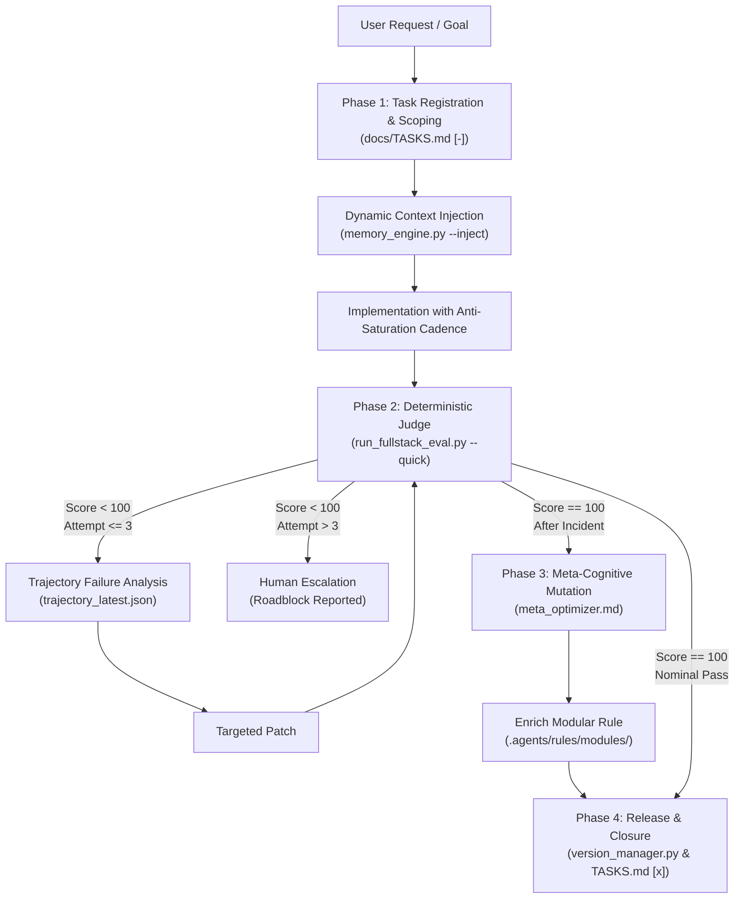

# Architecture Guide - Agentic RSI Protocol

This document provides a deep architectural breakdown of the **Recursive Self-Improvement (RSI) Protocol**, explaining its operational loops, memory governance, and deterministic evaluation harness.

---

## 1. Executive Overview

The **Agentic RSI Protocol** bridges the gap between probabilistic AI code generation and deterministic software engineering standards. It guarantees that an autonomous coding agent (Cursor, Windsurf, Google Antigravity, Claude Code, Cline, etc.):
1. **Never codes without an explicit contract** (SSOT in `docs/TASKS.md`).
2. **Never accumulates context bloat** (Modular memory < 80 lines per file).
3. **Never commits broken code** (Agnostic deterministic judge with 100/100 threshold).
4. **Learns recursively from failures** (Meta-cognitive rule distillation into procedural memory).

---

## 2. Core Architectural Pillars

### Pillar A: Memory Duality
AI agents typically degrade on long, complex projects due to two memory extremes:
- **Context saturation:** dumping hundreds of lines of static instructions into the chat prompt, causing attention dilution and forgotten constraints.
- **Session amnesia:** losing hard-won debugging insights the moment a chat session is closed.

The protocol resolves this via **Memory Duality**:
- **Episodic Memory (IDE Artifacts):** Volatile session tracking, step-by-step scratchpads, and visual task progress. Created in the IDE Brain folder and kept out of prompt chat tokens.
- **Procedural Memory (Modular Rules):** Permanent engineering rules stored in `.agents/rules/modules/`. Each module is strictly capped at **< 80 lines** to maintain ultra-fast inference and prevent LLM attention dilution (*"Lost in the Middle"*). When a module nears this ceiling, the agent applies a 2-step lossless consolidation strategy: first merging redundant or overlapping rules without losing technical precision, and second, splitting the module into finer domain sub-modules (and updating `MODULE_TRIGGERS` in `evals/memory_engine.py`) if all rules are distinct.

### Pillar B: The 4-Phase RSI Feedback Loop
Every non-trivial engineering task follows the `/rsi-feature` lifecycle:
1. **Preparation:** SSOT registration in `docs/TASKS.md`, stack inspection via `evals/stack_inspector.py`, and domain rule injection via `evals/memory_engine.py`.
2. **Deterministic Evaluation:** Fast verification via `python evals/run_fullstack_eval.py --quick` (capturing up to 10 significant lines of failure).
3. **Meta-Cognitive Mutation:** If an issue required debugging or security remediation, the agent assumes the `meta_optimizer` role to extract an atomic, preventative rule and registers it into the appropriate module.
4. **Release & Closure:** Automatic SemVer bump (`evals/version_manager.py`), changelog sealing, and task marking in `docs/TASKS.md`.

### Pillar C: Anti-Saturation Cadence
Running global test suites (`tsc --noEmit`, full linter, end-to-end tests) on every keystroke exhausts token limits and slows down editing.

The protocol enforces a 3-tier cadence:
- **Level 1 (Micro-edits):** 0 global checks. Keep editing fluid.
- **Level 2 (Milestone checkpoint):** Fast compact evaluation (`--quick`), evaluating only critical components and truncating outputs.
- **Level 3 (Task closure):** Full deterministic verification (Typecheck + Linter + Security + Database Schema + Memory Hygiene).

### Pillar D: Hybrid Pattern Recognition (Cognitive Compass + Reflex Nervous System)
Rather than relying solely on passive markdown instructions or heavy post-facto scripts, the architecture pairs both mechanisms:
1. **A Priori Cognitive Routing (`.agents/rules/modules/pattern_recognition.md`):** Guides the LLM before code generation using System 1/System 2 task classification (`[R-PAT-01]`), $O(1)$ structural mimicry (`[R-PAT-02]`), topological awareness (`[R-PAT-05]`), and strict scope discipline (`[R-PAT-06]`).
2. **A Posteriori Reflex Engine (`evals/memory_engine.py`, `evals/security_audit.py`, `evals/stack_inspector.py`, `evals/rsi_orchestrator.py`):** Provides `< 10ms` deterministic error signature matching (`--diagnose`), computes reverse-dependency Blast Radius (`--impact <file>`), enforces `Target files` scope alignment (`--scope`), and mechanically blocks operational anti-patterns (public secret env vars, non-singleton ORM clients, and dynamic `eval()` execution).

---

## 3. Tooling Ecosystem (`evals/`)

| Script | Purpose | Output Guarantee |
| :--- | :--- | :--- |
| `memory_engine.py` | Audits module limits, injects context rules, and diagnoses failure patterns (`--diagnose`). | Pure ASCII (`[OK]`, `[FAIL]`) |
| `run_fullstack_eval.py` | Multi-package manager test runner (pnpm, bun, yarn, npm, python). | Structured JSON report |
| `security_audit.py` | Detects hardcoded secrets, operational anti-patterns, ASCII violations, and `.gitignore` flaws. | Pure ASCII (`[SUCCESS]`) |
| `stack_inspector.py` | Analyzes stack, generates $O(1)$ Topological Map (`--map`), and computes Blast Radius (`--impact`). | Pure ASCII |
| `reset_rsi.py` | Resets tasks, logs, and changelog for starting fresh projects. | Pure ASCII + Zip backup |
| `version_manager.py` | Bumps SemVer versions, updates `package.json`, and seals `CHANGELOG.md`. | Pure ASCII |
| `rsi_orchestrator.py` | Cold-start session pulse (`--pulse`), retries (1..3), guardrails, Scope Drift (`--scope`), and task rollover (`--rollover`). | Pure ASCII + Exit codes |

---

## 4. Reset & Template Reuse (`/reset-rsi`)

When initiating a new repository from this template:
- Run `python evals/reset_rsi.py --force` (or invoke `/reset-rsi`).
- A zip backup is safely stored in `evals/backups/`.
- `docs/TASKS.md` is reset to a clean baseline (`TASK-INIT-01`).
- `CHANGELOG.md` is reset to `0.1.0 [Unreleased]`.
- All evaluation logs are pruned, giving the new project a spotless history.
